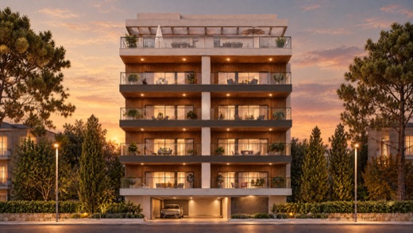

# DESIGN_NOTES — צאלים design system contract

Files: `css/site.css` (all styling incl. Leaflet 1.9.4 CSS), `js/site.js` (`window.TZ`). Plain HTML, RTL Hebrew, no build.
Pages never need their own header/footer markup: `site.js` renders them.

## 1. Page skeleton (every page)

```html
<!doctype html>
<html lang="he" dir="rtl">
<head>
  <meta charset="utf-8">
  <meta name="viewport" content="width=device-width,initial-scale=1,viewport-fit=cover">
  <title>שם הדף | צאלים קבלני בניין</title>
  <meta name="description" content="...">
  <link rel="preconnect" href="https://fonts.googleapis.com">
  <link rel="preconnect" href="https://fonts.gstatic.com" crossorigin>
  <link href="https://fonts.googleapis.com/css2?family=Heebo:wght@200;300;400;500;700&display=swap" rel="stylesheet">
  <link rel="stylesheet" href="css/site.css">
  <!-- optional page css: css/home.css | css/projects.css | css/content-pages.css (AFTER site.css) -->
</head>
<body data-page="home">
  <header id="site-header"></header>
  <main id="main">
    ...
  </main>
  <footer id="site-footer"></footer>

  <!-- ORDER MATTERS -->
  <script src="https://cdnjs.cloudflare.com/ajax/libs/leaflet/1.9.4/leaflet.js"></script> <!-- only pages with a map -->
  <script src="data/projects.js"></script>
  <script src="data/content.js"></script>
  <script src="js/site.js"></script>
  <script src="js/<page>.js"></script> <!-- optional, runs after site.js -->
</body>
</html>
```

- No other external CSS/JS. No localStorage/cookies. No fetch for local data.
- `site.js` runs its bootstrap on DOMContentLoaded: renders header/footer, adds skip link, WhatsApp FAB, mobile call bar, prototype chip, scroll state, reveal observer, `[data-count]` counters, and wires every `<form data-tz-form>`.
- Render your dynamic DOM (cards etc.) **before** DOMContentLoaded (inline/end-of-body script is fine). If you add `.reveal` elements later, call `TZ.initReveal()` again.
- `<main id="main">` is the skip-link target (JS adds `tabindex=-1`).

### body `data-page` keys
`home`, `projects`, `project`, `about`, `articles`, `article`, `contact`, `legal`.
Header highlight is automatic: `home`->ראשי; `projects` with `?status=marketing|construction|occupied` -> that item (no `status` => no highlight); `project` -> the status of `?p=<slug>`; `articles`/`article`->מאמרים; `about`; `contact`; `legal`->none.

Nav targets (fixed): `home.html`, `projects.html?status=marketing|construction|occupied`, `articles.html`, `about.html`, `contact.html`. **Contract for the projects page:** read `TZ.qs('status')`; absent = all projects (tabs: הכל / בשיווק / בבנייה / מאוכלסים).

### Header behaviour
- Pages with a `.hero` (or `<body data-header="over">`) get `body.header-over`: header is transparent, logo white (CSS filter), over the image. After scrolling >24px: solid bar (`--bg`), logo in original colours.
- All other pages: solid header from the start. Start the page with `.page-head` (it already pads for the fixed header, `--header-h` = 72px mobile / 84px desktop).
- Below 1080px: hamburger opens a full-screen menu (`#tz-menu`, rendered into `<body>`).

## 2. Tokens (`:root`)

Brand: `--cotton #EDEBDD`, `--cherry #810100`, `--maroon #630000`, `--noir #1B1717`.
Semantic (auto light/dark): `--bg --surface --surface-2 --text --muted --line --line-strong --accent --accent-hover --on-accent --accent-text --focus --danger --shadow --logo-filter`.
Spacing: `--s-1..--s-10` = 4 8 12 16 24 32 48 64 96 128px. `--gutter` 16px, `--container` 1240px, `--section-y` fluid 64-128px, `--radius` 2px, `--ease`.
Type: `--fs-display --fs-h1 --fs-h2 --fs-h3 --fs-h4 --fs-lead --fs-body --fs-small`.
Dark mode: automatic via `prefers-color-scheme`, or `<html data-theme="dark|light">`. Hero, footer, `.section--dark`, `.theme-dark` are ALWAYS dark (they redefine the tokens locally, so any component placed inside - buttons, forms, text - adapts automatically).

### Rules
- Use logical properties only (`margin-inline-start`, `padding-inline`, `inset-inline-end`, `text-align:start`). Never `left/right` for layout. Note: in RTL, "start" = right, "end" = left; the "next" arrow points LEFT.
- Colours: text = `var(--text)`, secondary = `var(--muted)`, borders `var(--line)`. Red (`--cherry`) is a FILL (buttons, badges, pins) with cotton text, never body text on dark. Small cherry text (eyebrow) only via `--accent-text`.
- Headings weight 200 (display/h1/h2), 300 (h3). Body 400. Heebo only.
- Vertical rhythm: sections use `.section`; inside use `--s-5`..`--s-8` gaps. Generous whitespace, few words, large photos.
- Every render image needs "הדמיה להמחשה בלבד" on its page: use `.render-note` (text) or `.media__note` (overlay on the image).
- Wrap phone numbers in `<bdi dir="ltr">052-8587821</bdi>` (or `.ltr`).
- Never invent facts; placeholders must be visibly marked (`.placeholder`, `.kv__v--empty`).
- Interactive carousel/tabs/lightbox must be keyboard operable. RTL keys: ArrowLeft = next, ArrowRight = previous.

## 3. CSS classes (purpose + markup)

### Layout & type
| class | purpose |
|---|---|
| `.container` | centered column, max 1240px, 16px gutters |
| `.section` / `.section--tight` / `.section--surface` / `.section--dark` / `.section--flush-top` | page bands (surface = alternate tint; dark = noir band, tokens flip) |
| `.grid` + `.grid--2/--3/--4` | auto-fill responsive grids (min col 460/300/240px, `--gap` overridable) |
| `.split` (+`--wide` 7:5, `--narrow` 5:7, `--top`) | two columns from 900px, stacked below |
| `.stack` / `.cluster` | vertical spacing via `--stack` / wrapping flex row via `--gap` |
| `.display .h1 .h2 .h3 .h4 .lead .small .muted .ltr` | type scale / helpers |
| `.eyebrow` | small tracked label with a line before it |
| `.section-head` | row: `.section-head__text` (eyebrow + `.section-title`) and an optional link at the end |
| `.page-head` | top block of inner pages (breadcrumb, h1, lead) |
| `.breadcrumb` | `<ol class="breadcrumb"><li><a>..</a></li><li>..</li></ol>` |
| `.media` (+`--zoom`) | fixed-ratio image box; set ratio with `style="--ratio:16/9"`; contains `` + optional `.media__note` |
| `.render-note` | small caption "הדמיה להמחשה בלבד" |
| `.prose` | readable long text (h2/h3/ul/ol/blockquote/img styled) |
| `.sr-only`, `.mt-4..8`, `.text-center`, `.hide-mobile`, `.hide-desktop`, `.rule` | utilities |

```html
<section class="section">
  <div class="container">
    <div class="section-head reveal">
      <div class="section-head__text">
        <span class="eyebrow">פרויקטים</span>
        <h2 class="section-title">פרויקטים בשיווק</h2>
      </div>
      <a class="link-arrow" href="projects.html?status=marketing">לכל הפרויקטים <!-- TZ.icon('arrow-next') --></a>
    </div>
    <div class="grid grid--3" id="cards"></div>      <!-- cards.innerHTML = list.map(TZ.projectCard).join('') -->
    <p class="render-note mt-5">הדמיה להמחשה בלבד</p>
  </div>
</section>
```
Inner page start:
```html
<section class="page-head"><div class="container">
  <ol class="breadcrumb"><li><a href="home.html">ראשי</a></li><li>אודות</li></ol>
  <h1>אודות</h1><p class="lead">...</p>
</div></section>
```

### Buttons
`.btn` cherry fill; `.btn--ghost` outline (light bg); `.btn--light` outline for dark bg; `.btn--cotton` solid cotton for dark bg; `.btn--sm`; `.btn--block`; `.link-arrow` underlined text link. Icons inside buttons: `TZ.icon('arrow-next','icon--arrow')` (nudges on hover).
```html
<a class="btn" href="#cta">השאר פרטים</a> <a class="btn btn--ghost" href="contact.html">צור קשר</a>
```

### Header / footer / floating (rendered by JS, listed for reference)
`.site-header` (`.is-scrolled`), `.logo`, `.nav`, `.nav__link[aria-current]`, `.nav-toggle`, `.menu` (+`body.menu-open`), `.site-footer*`, `.icon-btn`, `.fab-wa`, `.callbar`, `.proto-chip`, `.skip-link`.

### Hero carousel (home owner builds behaviour; CSS is ready)
State classes: `.hero__slide.is-active` (visible, zoom runs), `.hero__dot.is-active`, `.hero.is-playing` (progress bar on active dot runs for `--hero-dur`, default 6.5s; set `style="--hero-dur:6.5s"`), `.hero.is-paused` (pauses progress). Slide is hidden by CSS unless `.is-active`; fade 1.3s. When switching, just move `.is-active` (no `is-leaving` needed).
```html
<section class="hero" aria-roledescription="carousel" aria-label="פרויקטים נבחרים">
  <h1 class="sr-only">צאלים קבלני בניין — יש על מי לסמוך</h1>
  <div class="hero__slides">
    <div class="hero__slide is-active" role="group" aria-roledescription="שקופית" aria-label="1 מתוך 5" style="--pos:50% 62%">
      
      <div class="hero__copy">                       <!-- children animate in order: label, title, lead, actions, link -->
        <p class="hero__label">בלינסון 49 · קרית חיים · בשיווק</p>
        <h2 class="hero__title">יש על מי לסמוך</h2>
        <p class="hero__lead">קבלני בניין בקריות, מאז 1991</p>
        <div class="hero__actions"><a class="btn" href="#cta">השאר פרטים</a><a class="btn btn--light" href="projects.html?status=marketing">לפרויקטים בשיווק</a></div>
        <a class="hero__link" href="project.html?p=SLUG">לעמוד הפרויקט</a>
      </div>
    </div>
    <!-- more slides -->
  </div>
  <div class="hero__ui">
    <div class="hero__dots"><button class="hero__dot is-active" aria-label="שקופית 1"></button>...</div>
    <div class="hero__side">
      <div class="hero__thumbs"><button class="hero__thumb" aria-label="מעבר לבלינסון 42"><span>בלינסון 42</span></button> x2 (next two slides)</div>
      <div class="hero__nav">
        <button class="hero__arrow" aria-label="הקודם"><!-- TZ.icon('arrow-prev') --></button>
        <button class="hero__arrow" aria-label="הבא"><!-- TZ.icon('arrow-next') --></button>
      </div>
    </div>
  </div>
  <p class="hero__note">הדמיה להמחשה בלבד</p>
</section>
```
(In RTL the first child of `.hero__ui` sits on the right; thumbs hidden under 960px. `--pos` = object-position per slide. The logo layer is the fixed header, so it stays continuous across slides.)

### Project card, badges, tabs
`TZ.projectCard(p, i)` returns the card HTML (see §4). Classes inside: `.pcard`, `.pcard__media`, `.pcard__badge`, `.pcard__sold`, `.pcard__body`, `.pcard__city`, `.pcard__name`, `.pcard__text`, `.pcard__more`.
Badges: `<span class="badge badge--marketing|construction|occupied|outline">`.
Tabs (you handle the JS; set `aria-selected`):
```html
<div class="tabs" role="tablist" aria-label="סינון פרויקטים">
  <button class="tab" role="tab" aria-selected="true">הכל <span class="tab__count">22</span></button>
  <button class="tab" role="tab" aria-selected="false">בשיווק <span class="tab__count">4</span></button>
</div>
```
`.chip` (pill filter; `aria-pressed="true"` = active).

### Trust bar, values, articles, gallery, details, logos, CTA
```html
<div class="trust">
  <div class="stat reveal"><div class="stat__num" data-count="35" data-suffix="+">35+</div><div class="stat__label">שנות ניסיון</div></div> ...
</div>
<div class="values">
  <div class="value reveal"><div class="value__num">01</div><h3 class="value__title">כותרת</h3><p class="value__text">טקסט</p></div>
</div>
<a class="acard reveal" href="article.html?id=ID">
  <div class="acard__media media media--zoom" style="--ratio:16/10"></div>
  <div class="acard__meta">תאריך</div><h3 class="acard__title">כותרת</h3><p class="acard__text">תקציר</p><span class="acard__more">קראו עוד</span>
</a>
<div class="gallery" id="gal">
  <a class="gallery__item" href="img/p/slug/1.jpg" data-lightbox data-kind="render" data-alt="תיאור"></a>
</div>   <!-- TZ.initLightbox('#gal'); data-kind="render" or data-render adds "הדמיה להמחשה בלבד" in the lightbox; .gallery__item--wide spans 2 cols -->
<div class="kv">  <!-- project "details infrastructure" -->
  <div class="kv__row"><div class="kv__k">מספר יחידות</div><div class="kv__v kv__v--empty">יעודכן</div></div>
</div>
<div class="placeholder"><span class="placeholder__tag">מציין מקום</span><p>אזור לתיאור חופשי...</p></div>
<div class="logos"></div>
<div class="cta"><div><span class="eyebrow">..</span><h2 class="cta__title">..</h2><p class="cta__text">..</p></div><form class="form" data-tz-form>..</form></div>   <!-- put inside .section--dark -->
```
`.stat__num` is forced LTR so "35+" renders correctly.

### Forms
```html
<form class="form" data-tz-form>            <!-- auto-wired; or TZ.initForm(form) -->
  <div class="form__row form__row--2">
    <div class="field"><label for="f-name">שם מלא</label><input id="f-name" name="name" autocomplete="name"></div>
    <div class="field"><label for="f-phone">טלפון</label><input id="f-phone" name="phone" type="tel" inputmode="tel" autocomplete="tel"></div>
  </div>
  <div class="field"><label for="f-msg">הודעה <span class="field__opt">(לא חובה)</span></label><textarea id="f-msg" name="message"></textarea></div>
  <div class="consent"><input type="checkbox" id="f-c" name="consent"><label for="f-c">אני מאשר/ת יצירת קשר חוזר. <a href="legal.html?doc=privacy">מדיניות פרטיות</a></label></div>
  <button class="btn" type="submit">שליחה</button>
  <p class="form__note">הפרטים לא נשלחים (אבטיפוס).</p>
</form>
```
Required: `name` (>=2 chars), `phone` (valid Israeli number), `consent`; optional `email` is validated if present. Errors are injected as `.field__error` + `.field--error`. Success replaces the form with `.form__success` ("תודה, נחזור אליך בהקדם" + prototype note). Field names must be exactly `name`, `phone`, `email`, `consent`.

### Map
`<div id="map"></div>` (gets `.map`, height clamp 380-620px; modifiers `.map--tall`, `.map--short`; override height with CSS on your own class if needed) + optional legend:
```html
<div class="map-legend"><span><i></i>בשיווק ובבנייה</span><span><i class="is-past"></i>מאוכלסים</span></div>
```
Pins: `.tz-pin.pin--active` (34px cherry, pulsing ring) / `.tz-pin.pin--past` (15px muted). Popup: `.map-card` (thumbnail, `.badge`, name, city, CTA link to `project.html?p=<slug>`). The container keeps `--surface-2` background if tiles fail. Note: CARTO tiles can show an "API KEY REQUIRED" watermark when opened via file:// (no referrer); pins still work.

### Lightbox, reveal, motion
- `.lightbox*` is built by `TZ.initLightbox`. Esc closes, arrows (RTL aware), swipe, focus trap.
- Reveal: add `class="reveal"` and optional `style="--i:N"` (stagger 90ms per step; `TZ.projectCard(p, i)` sets it). Variants `.reveal--fade`, `.reveal--left`. Visible state `.is-visible`. All motion is off under `prefers-reduced-motion`.

## 4. `window.TZ` API

| signature | notes |
|---|---|
| `TZ.renderHeader(activeKey)` | into `#site-header`; keys `home marketing construction occupied articles about contact`. Called automatically |
| `TZ.renderFooter()` | into `#site-footer`. Automatic |
| `TZ.projectCard(p, i?) -> string` | HTML of a card (`a.pcard.reveal`), image from `p.cover`, badge, "נמכר" tag if `p.sold`, city + address, text = `p.desc` shortened to ~110 chars (omitted if empty). Optional `i` = stagger index. All values escaped |
| `TZ.statusLabel(status) -> string` | marketing/construction/occupied -> בשיווק/בבנייה/מאוכלס |
| `TZ.cityLabel(city) -> string` | kiryat-haim/kiryat-motzkin -> קרית חיים/קרית מוצקין |
| `TZ.qs(name) -> string\|null` | query-string param |
| `TZ.byStatus(status) -> array` | filters `window.PROJECTS` |
| `TZ.bySlug(slug) -> project\|null` | |
| `TZ.initReveal()` | observes `.reveal` (call again after injecting more) |
| `TZ.initLightbox(containerSelectorOrEl)` | delegates clicks on `a[data-lightbox]` inside the container |
| `TZ.initMap(elOrSelector, projects, {onlyActive?, popup?, fit?}) -> {map, markers, focus(slug)}\|null` | Leaflet; returns null with a Hebrew fallback message if `window.L` is missing. Defaults: popup true, fit true (fits Kiryat Haim pins, max zoom 15; a single project -> zoom 16). `onlyActive:true` hides occupied pins |
| `TZ.initForm(formElOrSelector)` | validation + success state |
| `TZ.countUp(el)` | animates `data-count`, optional `data-suffix`, `data-prefix`, `data-decimals`, `data-duration`; auto-triggered on view for `[data-count]` |
| `TZ.icon(name, extraClass?) -> svg string` | names: `phone whatsapp facebook arrow-next arrow-prev chevron-next chevron-prev chevron-down close pin check` (`arrow-next` points left = forward in RTL) |
| `TZ.esc(str)` | HTML-escape; use for any data you inject |
| `TZ.mapCard(p)` | popup card HTML |
| `TZ.config`, `TZ.nav`, `TZ.reducedMotion()` | contact facts / nav list / media query helper |

## 5. Recipes
- **Featured projects**: `.section` > `.container` > `.section-head` + `.grid.grid--3` filled with `TZ.byStatus('marketing').map(TZ.projectCard).join('')`.
- **Dark CTA with form**: `<section class="section section--dark" id="cta"><div class="container cta">...</div></section>`; buttons inside stay cherry; ghost buttons use `.btn--light`.
- **Two-column story**: `.split` with `.media` on one side and `.stack` text on the other.
- **Project page hero**: `<body data-header="over">`, a dark full-width cover with `.theme-dark` + a gradient overlay of your own, then normal sections.
- Render note: anywhere a page shows render images add `<p class="render-note">הדמיה להמחשה בלבד</p>`.
